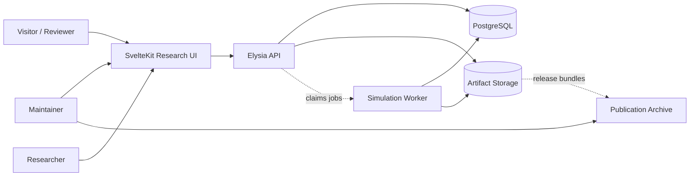
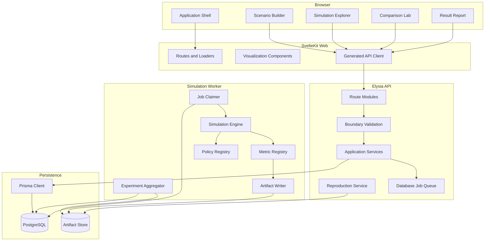
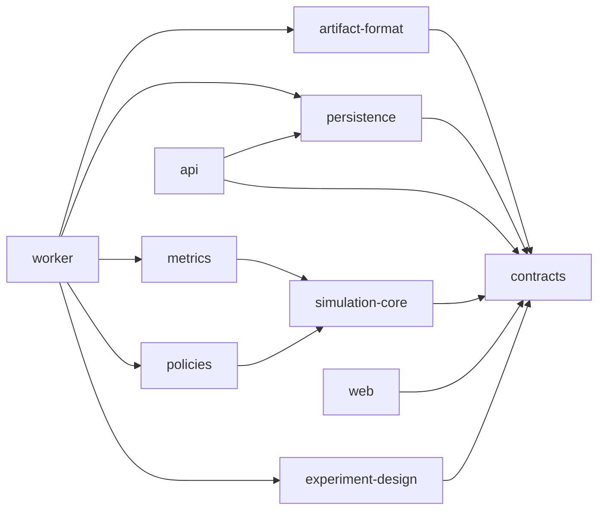
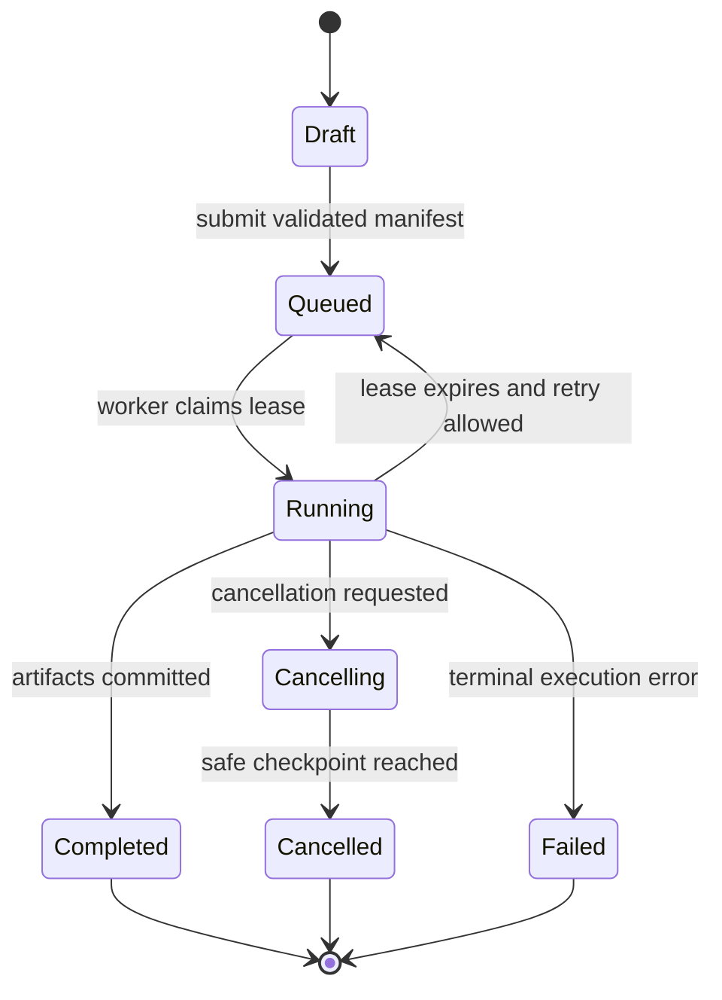
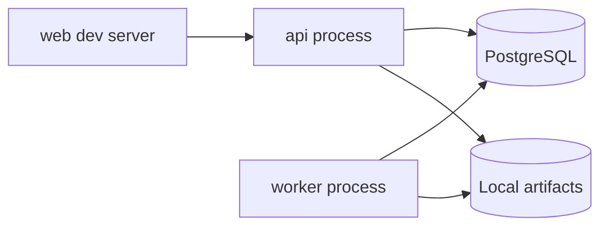

# System Design

## Computational Laboratory for Recommendation-Driven Social Dynamics

| Attribute | Value |
|---|---|
| Document status | Proposed implementation design |
| Version | 1.0 |
| Date | 2026-09-12 |
| Related requirements | [`BRD.md`](./BRD.md) |
| Architecture style | Modular monolith with isolated simulation worker |
| Frontend | SvelteKit 5 |
| API | Elysia.js on Bun |
| ORM | Prisma |
| Database | PostgreSQL |

> **Scope statement:** This design is for a new standalone research project. It is unrelated to and does not modify the attached `diaspora-events` repository.

> **Schema statement:** The entities and Prisma models described below are recommendations for later implementation. No database schema or migration has been created by these documents.

---

## 1. Purpose

This document defines the technical architecture for a reproducible agent-based research platform that evaluates how event recommendation policies influence social exposure, participation, network formation, provider concentration, and segregation over time.

The system must support two modes without maintaining two products:

1. **Research mode:** configure scenarios, run multi-seed experiments, inspect assumptions, analyze uncertainty, and export reproducible results.
2. **Narrative mode:** present canonical experiments through a polished, accessible, publication-quality interface.

The architecture prioritizes scientific determinism, explicit contracts, auditability, and manageable implementation scope over distributed-system complexity.

---

## 2. Architecture Drivers

1. **Determinism:** simulation results must depend only on versioned inputs and seeded randomness.
2. **Long-running work:** batch experiments cannot occupy request handlers.
3. **Reproducibility:** every result must include configuration, seed, code/model/policy versions, and checksums.
4. **Scientific isolation:** model logic cannot depend on Svelte, Elysia, Prisma, HTTP, or database records.
5. **Interactive exploration:** users need streaming progress and checkpoint playback.
6. **Bounded resources:** public or local workloads must have explicit limits.
7. **Transparent persistence:** PostgreSQL stores authoritative metadata and summaries; large trajectories belong in artifacts.
8. **Accessible analytical UI:** charts, animation, and color must have equivalent textual and tabular representations.
9. **Extensibility:** adding a recommendation policy or metric should not require rewriting orchestration or UI contracts.
10. **Minimal operational burden:** one deployable API and one worker are preferable to premature microservices.

---

## 3. Constraints and Decisions

### 3.1 Approved technology choices

| Choice | Reason | Already exists | Consequence if omitted or replaced |
|---|---|---|---|
| SvelteKit 5 | Supports a responsive, high-performance analytical UI with strong component composition | Approved, not implemented | A different frontend breaks the agreed stack and design plan |
| Elysia.js on Bun | Typed, high-performance API and schema-driven validation | Approved, not implemented | Another backend requires redesigning API integration and runtime assumptions |
| Prisma | Explicit relational schema, generated client, and migrations | Approved, not implemented | Replacing it changes persistence contracts and migration tooling |
| PostgreSQL | Durable relational metadata, JSON support, transactions, mature operations | Approved, not implemented | SQLite limits hosted concurrency; document stores weaken experiment relationships |

### 3.2 Recommended architecture: modular monolith plus worker

The system will begin as a modular monorepo with:

- A SvelteKit web application.
- An Elysia API application.
- A simulation worker process.
- Shared contract, simulation, metrics, policy, and design-token packages.
- One PostgreSQL database.
- Local filesystem artifacts in development and an object-storage adapter in hosted environments.

**Reason:** request/response concerns and CPU-heavy simulation require process isolation, but the domain does not justify independently deployed microservices.
**Already exists:** no project implementation exists.
**Consequence if omitted:** running simulations in API handlers risks timeouts and blocked traffic; full microservices add unnecessary deployment and consistency complexity.

### 3.3 Not selected initially

- Microservices.
- Kubernetes.
- Kafka or a distributed event bus.
- Graph database.
- Redis as a mandatory dependency.
- Python as the primary simulation runtime.
- User-supplied executable policy code.

Each may be reconsidered only when measured constraints justify it.

---

## 4. System Context



### 4.1 Trust boundaries

- Browser input is untrusted.
- API validates all configuration and identifiers.
- Worker trusts only immutable, validated run manifests retrieved from persistence.
- Artifact contents are checksummed before being marked authoritative.
- Publication archives are external immutable destinations.

---

## 5. Container Architecture



---

## 6. Repository Structure

Recommended structure:

```text
eventscape/
├── apps/
│   ├── web/                    # SvelteKit application
│   ├── api/                    # Elysia HTTP API
│   └── worker/                 # Simulation and aggregation worker
├── packages/
│   ├── contracts/              # Runtime schemas and transport types
│   ├── simulation-core/        # Pure model and deterministic RNG
│   ├── policies/               # Recommendation policy implementations
│   ├── metrics/                # Scientific metric implementations
│   ├── experiment-design/      # Factor expansion and matched-seed planning
│   ├── persistence/            # Prisma client and repositories
│   ├── artifact-format/        # Manifests, checksums, readers/writers
│   ├── ui/                     # Svelte analytical components
│   └── design-tokens/          # Primitive → semantic → component tokens
├── prisma/
│   ├── schema.prisma
│   └── migrations/
├── research/
│   ├── protocols/
│   ├── canonical-scenarios/
│   ├── metric-dictionary/
│   ├── analysis/
│   └── figures/
├── docs/
│   ├── decisions/
│   ├── methodology/
│   └── operations/
├── tests/
│   ├── reproducibility/
│   ├── performance/
│   └── e2e/
├── BRD.md
└── SYSTEM_DESIGN.md
```

### 6.1 Package dependency rule



`simulation-core`, `policies`, and `metrics` must never depend on API, UI, or persistence packages.

---

## 7. Domain Boundaries

### 7.1 Methodology module

Owns:

- Model versions.
- Parameter definitions.
- Canonical scenario definitions.
- Metric definitions and citations.
- Policy metadata.

Does not execute runs.

### 7.2 Experiment-design module

Owns:

- Factor definitions.
- Cartesian and constrained design expansion.
- Seed allocation.
- Matched-seed blocks.
- Run-count and resource estimation.
- Confirmatory/exploratory labels.

### 7.3 Simulation module

Owns:

- Model state.
- Seeded randomness.
- Event generation.
- Candidate feasibility.
- Attendance decisions.
- Capacity resolution.
- Tie formation and decay.
- State checkpoints.

### 7.4 Recommendation-policy module

Owns:

- Candidate scoring.
- Ranking.
- Reranking.
- Explanation factors.
- Policy-specific parameters.

It does not mutate simulation state.

### 7.5 Metrics module

Owns:

- Online timestep metrics.
- Terminal metrics.
- Metric validity and edge-case handling.
- Sufficient statistics for aggregation.

### 7.6 Orchestration module

Owns:

- Experiment and run lifecycle.
- Job claiming.
- Progress reporting.
- Retry/cancellation behavior.
- Aggregation scheduling.

### 7.7 Reproduction module

Owns:

- Manifest generation.
- Canonical serialization.
- Checksums.
- Output verification.
- Bundle export and import.

### 7.8 Publication module

Owns:

- Immutable snapshots.
- Public scenario metadata.
- Citation blocks.
- Figure-to-run provenance.

---

## 8. Simulation Engine Design

### 8.1 Deterministic execution contract

A run is a pure conceptual function:

$$
Output = F(ModelVersion, PolicyVersion, Configuration, Seed)
$$

The implementation may stream progress and persist checkpoints, but those side effects must not alter `Output`.

### 8.2 Run lifecycle



### 8.3 Timestep pipeline

For each timestep:

1. Generate or activate events using the exogenous event stream.
2. Update availability and expire old events.
3. Build feasible candidates per agent.
4. Score candidates through the selected policy.
5. Produce top-$k$ recommendation lists and explanations.
6. Sample attendance decisions using the seeded RNG.
7. Resolve capacities with a deterministic lottery if oversubscribed.
8. Update popularity and attendance histories.
9. Form, strengthen, decay, or remove social ties.
10. Compute online metrics.
11. Persist progress and optional checkpoint artifacts.

### 8.4 Random-number generation

Use a documented pseudorandom generator with explicit state and stream splitting.

Required streams:

- Population initialization.
- Network initialization.
- Event supply.
- Recommendation tie-breaking.
- Attendance choice.
- Capacity resolution.
- Tie formation.

Derive independent stream seeds from the run seed and stable stream names. This avoids changing attendance randomness when an unrelated random operation is added elsewhere.

**Reason:** a single global RNG makes results fragile to implementation order.
**Already exists:** no implementation exists.
**Consequence if omitted:** minor refactors can alter all subsequent random draws and invalidate reproduction.

### 8.5 State representation

Use dense numeric arrays or typed arrays for frequently accessed agent and event fields, and adjacency lists for sparse social ties. Domain wrappers may provide readable interfaces, but timestep hot paths should avoid per-agent object allocation.

Recommended in-memory state:

```text
SimulationState
├── timestep
├── agents
│   ├── group[N]
│   ├── position[N,2]
│   ├── interests[N,D]
│   ├── availability[N]
│   ├── exploration[N]
│   └── attendanceHistory
├── events
│   ├── active[M]
│   ├── organizer[M]
│   ├── topics[M,D]
│   ├── position[M,2]
│   ├── start[M]
│   ├── capacity[M]
│   └── popularity[M]
├── network
│   └── adjacencyList
└── rngStreams
```

### 8.6 Candidate generation

A candidate event must satisfy hard feasibility constraints before scoring:

- Event is active and future-facing.
- Agent is available.
- Event is within configured maximum distance or remote-access rule.
- Event has potential capacity.
- Event is not excluded by scenario rules.

Ranking policies must not bypass candidate feasibility. This separates “can attend” from “would prefer.”

### 8.7 Attendance choice

The decision model must be a versioned, inspectable function. A logistic utility model is recommended initially because it is bounded, interpretable, and straightforward to calibrate.

The system must support:

- At most one event per conflicting time window unless a scenario explicitly permits otherwise.
- Outside-option rejection.
- Capacity-aware deterministic allocation.
- Optional companion effect.
- Policy-independent decision semantics for fair comparison.

### 8.8 Tie update

The baseline should support:

- Tie creation probability from co-attendance opportunity.
- Tie strengthening from repeated co-attendance.
- Optional tie decay.
- Configurable cross-group interaction quality.
- Maximum edge weight.

Tie semantics must remain policy-independent. Policies influence exposure and attendance; they must not directly create edges.

### 8.9 Checkpoint strategy

- Record metrics every timestep.
- Record compact network/event checkpoints at a configurable interval.
- Record full terminal state.
- Do not write complete normalized state for every agent at every timestep to PostgreSQL.

This reduces storage while preserving animation, selected-state inspection, and reproducibility.

---

## 9. Recommendation Policy Interface

Recommended TypeScript contract:

```typescript
interface RecommendationPolicy {
  readonly id: string;
  readonly version: string;
  readonly parameterSchemaVersion: string;

  rank(context: RankingContext): RankedRecommendation[];
}

interface RankingContext {
  timestep: number;
  agentIndex: number;
  candidateEventIndices: readonly number[];
  state: ReadonlySimulationView;
  parameters: Readonly<Record<string, unknown>>;
  tieBreaker: DeterministicTieBreaker;
}

interface RankedRecommendation {
  eventIndex: number;
  score: number;
  rank: number;
  factors: Readonly<Record<string, number>>;
}
```

### 9.1 Policy rules

- Policies return scores and explanations but do not mutate state.
- Scores must be finite.
- Ranking must be stable under equal scores using seeded deterministic tie-breaking.
- Policy parameters require runtime validation.
- A policy version changes whenever output can change for unchanged input.
- Experimental policies must carry an `experimental` status.

### 9.2 Bridge-aware reranking

Use a two-stage design:

1. **Relevance qualification:** generate the top $n$ feasible items by relevance.
2. **Constrained reranking:** select top $k$ by marginal objective improvement.

A maximal marginal relevance-style objective is suitable for MVP:

$$
\operatorname*{argmax}_{e \in C \setminus L}
\left[
\alpha R(u,e)+
\beta X(u,e)+
\gamma O(e)-
\delta P(e)-
\eta Redundancy(e,L)
\right]
$$

This avoids recommending completely irrelevant events merely to increase diversity.

### 9.3 Policy explanation

Every selected item stores normalized factor contributions such as:

- interest match
- distance compatibility
- schedule compatibility
- social signal
- expected cross-group exposure
- organizer coverage contribution
- popularity penalty
- list redundancy penalty

Explanations are for model inspection, not post-hoc natural-language persuasion.

---

## 10. Metrics Architecture

Recommended contract:

```typescript
interface MetricDefinition<State = SimulationState> {
  readonly id: string;
  readonly version: string;
  readonly scope: 'TIMESTEP' | 'TERMINAL' | 'AGGREGATE';
  readonly unit: string;
  readonly direction: 'HIGHER' | 'LOWER' | 'CONTEXTUAL';

  compute(input: MetricInput<State>): MetricResult;
}
```

### 10.1 Metric families

- Utility.
- Exposure.
- Participation.
- Network integration.
- Organizer/provider fairness.
- Computational diagnostics.

### 10.2 Required metric metadata

- Formula.
- Interpretation.
- Valid range.
- Unit.
- Preferred direction, if meaningful.
- Undefined-state behavior.
- Required state.
- Scientific citation where applicable.
- Version.

### 10.3 Initial metrics

| Metric | Formula/approach | Edge behavior |
|---|---|---|
| Attendance rate | attended opportunities / eligible agents | Report denominator explicitly |
| Exposure entropy | Shannon entropy over exposed groups/topics | Zero for one-category exposure |
| Assortativity | nominal assortativity by synthetic group | Null plus reason when no eligible edges |
| Modularity | fixed seeded community algorithm | Algorithm and seed stored |
| Cross-group tie rate | new cross-group edges / all new edges | Null when no new edges |
| Exposure Gini | Gini over organizer exposure counts | Zero for equal exposure; define all-zero case |
| Long-tail coverage | exposed long-tail events / available long-tail events | Threshold definition versioned |
| Intra-list diversity | mean pairwise dissimilarity | Zero for lists shorter than two |
| Mean relevance | mean relevance among displayed/selected events | Display exposure and attendance variants separately |

### 10.4 Aggregation

- Aggregate only completed runs by default.
- Preserve matched-seed blocks.
- Store replication count and interval method.
- Use independent run summaries, not raw timestep observations, for inferential uncertainty.
- Record analysis-version metadata separately from simulation-version metadata.

---

## 11. Experiment Design

### 11.1 Configuration hierarchy

```text
Model Configuration
├── population
├── initial network
├── event supply
├── attendance behavior
├── tie dynamics
├── temporal horizon
└── metric schedule

Policy Configuration
├── policy ID/version
├── policy parameters
└── list/candidate sizes

Experiment Configuration
├── factors and levels
├── constraints
├── policies
├── seeds
├── confirmatory label
└── analysis plan reference
```

### 11.2 Canonical serialization

- Serialize using sorted keys and normalized numeric forms.
- Exclude display-only metadata from the scientific fingerprint.
- Include schema versions.
- Reject unknown fields by default.
- Compute SHA-256 for configuration and manifest fingerprints.

### 11.3 Matched seeds

A matched block shares exogenous initialization across policies:

- Population attributes.
- Initial network.
- Event supply stream.

Policy-dependent stochastic decisions use derived streams tied to the same base seed. The matching strategy and its limitations must be documented because policy choices change subsequent endogenous state.

### 11.4 Resource estimation

Before submission, estimate:

$$
Runs = |Policies| \times |Seeds| \times \prod_i |Factor_i|
$$

Show expected timesteps, rough storage, and workload class. The API must reject designs above configured limits unless an authorized local/maintainer override exists.

---

## 12. Persistence Design

### 12.1 Persistence strategy

PostgreSQL is authoritative for:

- Version registries.
- Scenario and experiment definitions.
- Run lifecycle and leases.
- Metric summaries.
- Artifact metadata and checksums.
- Published snapshots.

Artifact storage is authoritative for:

- Checkpoint trajectories.
- Full terminal state.
- Tidy metric exports.
- Logs required for reproduction.
- Figure data.
- Reproduction bundles.

### 12.2 Proposed entities

These are **recommended future schema models**, not current schema changes.

| Entity | Purpose | Why required | Consequence if omitted |
|---|---|---|---|
| `ModelVersion` | Identifies immutable model semantics | Reproduction and change control | Results cannot be interpreted across model changes |
| `PolicyVersion` | Identifies policy implementation and parameters | Auditable comparisons | Algorithm changes become invisible |
| `Scenario` | Reusable validated scientific configuration | Canonical and user-defined scenarios | Configurations become duplicated and untraceable |
| `Experiment` | Research design and hypothesis metadata | Groups runs under one analysis plan | Batch results lose scientific context |
| `Run` | One policy/configuration/seed execution | Independent unit of analysis | No lifecycle, pairing, or reproduction identity |
| `RunMetric` | Timestep or terminal metric values | Queryable progress and summaries | Every chart requires loading large artifacts |
| `Artifact` | URI, media type, checksum, and provenance | Integrity and export | Large outputs become unaudited files |
| `PublishedSnapshot` | Immutable public result reference | Stable portfolio/publication links | Public results can drift after edits |

### 12.3 Entities intentionally omitted from MVP

- User accounts.
- Teams/workspaces.
- Real event records.
- Real demographic profiles.
- Separate normalized agent/event state tables.
- Billing and quotas.

**Reason:** none are needed to test the approved scientific questions.
**Already exists:** no schema exists.
**Consequence if added prematurely:** migration burden and privacy/authorization complexity increase without scientific value.

### 12.4 Proposed Prisma model sketch

This sketch communicates relationships only; it is not a migration-ready schema.

```prisma
model ModelVersion {
  id          String   @id
  version     String   @unique
  status      VersionStatus
  manifest    Json
  createdAt   DateTime @default(now())
  runs        Run[]
}

model PolicyVersion {
  id          String   @id
  policyId    String
  version     String
  status      VersionStatus
  manifest    Json
  createdAt   DateTime @default(now())
  runs        Run[]

  @@unique([policyId, version])
}

model Scenario {
  id                    String   @id
  name                  String
  schemaVersion         String
  scientificFingerprint String   @unique
  configuration         Json
  isCanonical           Boolean  @default(false)
  createdAt             DateTime @default(now())
  experiments           Experiment[]
}

model Experiment {
  id                  String   @id
  name                String
  classification      StudyClassification
  hypothesisIds       String[]
  designSchemaVersion String
  design              Json
  scenarioId          String
  scenario            Scenario @relation(fields: [scenarioId], references: [id])
  createdAt           DateTime @default(now())
  runs                 Run[]
  snapshots            PublishedSnapshot[]
}

model Run {
  id                    String   @id
  experimentId          String
  experiment            Experiment @relation(fields: [experimentId], references: [id])
  modelVersionId        String
  modelVersion          ModelVersion @relation(fields: [modelVersionId], references: [id])
  policyVersionId       String
  policyVersion         PolicyVersion @relation(fields: [policyVersionId], references: [id])
  seed                  BigInt
  scientificFingerprint String   @unique
  status                RunStatus
  progress              Float    @default(0)
  leaseOwner            String?
  leaseExpiresAt        DateTime?
  attemptCount          Int      @default(0)
  startedAt             DateTime?
  completedAt           DateTime?
  failureCode           String?
  failureDetail         Json?
  metrics               RunMetric[]
  artifacts             Artifact[]
  createdAt             DateTime @default(now())

  @@index([status, leaseExpiresAt])
  @@index([experimentId, status])
}

model RunMetric {
  id            String   @id
  runId         String
  run           Run      @relation(fields: [runId], references: [id], onDelete: Cascade)
  metricId      String
  metricVersion String
  timestep      Int?
  value         Float?
  valueJson     Json?
  createdAt     DateTime @default(now())

  @@unique([runId, metricId, metricVersion, timestep])
  @@index([runId, timestep])
}

model Artifact {
  id          String   @id
  runId       String?
  run         Run?     @relation(fields: [runId], references: [id], onDelete: Cascade)
  kind        ArtifactKind
  uri         String
  mediaType   String
  sha256      String
  byteSize    BigInt
  manifest    Json
  createdAt   DateTime @default(now())
}

model PublishedSnapshot {
  id             String   @id
  slug           String   @unique
  experimentId   String
  experiment     Experiment @relation(fields: [experimentId], references: [id])
  manifest       Json
  manifestSha256 String
  publishedAt    DateTime @default(now())
}
```

### 12.5 Indexing rationale

- Queue claiming needs `(status, leaseExpiresAt)`.
- Experiment pages need `(experimentId, status)`.
- Metric playback needs `(runId, timestep)`.
- Unique scientific fingerprints prevent accidental duplicate work and support idempotency.

### 12.6 Transaction boundaries

- Experiment submission creates the experiment and all planned run records atomically.
- Worker claim updates lease and status atomically using compare-and-set semantics.
- Completion transaction verifies artifacts, inserts terminal metrics, and changes run status last.
- Published snapshot creation stores an immutable manifest and checksum in one transaction.

---

## 13. Job Queue and Worker Design

### 13.1 Database-backed queue

Use PostgreSQL row locking for MVP:

1. Worker selects an eligible queued or expired-leased run using `FOR UPDATE SKIP LOCKED` through a safe repository abstraction.
2. Worker assigns a lease owner and expiry.
3. Worker periodically renews the lease.
4. Completion or failure clears the lease and sets terminal state.
5. Expired leases can be retried within attempt limits.

**Reason:** avoids adding Redis before workload proves it necessary.
**Already exists:** no implementation exists.
**Consequence if omitted:** CPU-bound work remains in request handlers or requires an unnecessary external queue dependency.

Prisma may require a narrowly scoped parameterized raw query for `SKIP LOCKED`; this query must be isolated, tested, and documented.

### 13.2 Idempotency

- Run scientific fingerprint is unique.
- Completion checks terminal status before writing.
- Artifact paths include run ID and content checksum.
- Retried runs overwrite only temporary attempt paths; authoritative artifacts are committed once.
- Aggregation uses experiment ID plus analysis version as an idempotency key.

### 13.3 Cancellation

- API marks cancellation requested.
- Worker checks at timestep/checkpoint boundaries.
- Worker writes an incomplete manifest, closes temporary resources, and marks cancelled.
- Cancelled runs are excluded from confirmatory aggregation by default.

### 13.4 Failure classification

- `INVALID_MANIFEST`
- `MODEL_INVARIANT_VIOLATION`
- `RESOURCE_LIMIT_EXCEEDED`
- `ARTIFACT_WRITE_FAILED`
- `LEASE_LOST`
- `CANCELLED`
- `UNEXPECTED_RUNTIME_ERROR`

Public errors must not expose stack traces or infrastructure secrets.

---

## 14. API Design

### 14.1 Conventions

- Base path: `/api/v1`.
- JSON request/response bodies.
- camelCase fields.
- ULID or UUID identifiers; choose one before implementation.
- Cursor pagination for list endpoints.
- ISO 8601 UTC timestamps.
- Structured errors.
- Runtime validation through Elysia schemas/type system.
- Generated OpenAPI document.

### 14.2 Error envelope

```json
{
  "error": {
    "code": "INVALID_EXPERIMENT_DESIGN",
    "message": "The requested design exceeds the maximum run count.",
    "details": {
      "requestedRuns": 12000,
      "maximumRuns": 1000
    },
    "requestId": "req_..."
  }
}
```

### 14.3 Endpoint inventory

#### Methodology

| Method | Path | Purpose |
|---|---|---|
| GET | `/methodology/model-versions` | List supported model versions |
| GET | `/methodology/model-versions/:version` | Read model and parameter metadata |
| GET | `/methodology/policies` | List policies and parameter schemas |
| GET | `/methodology/metrics` | Read metric dictionary |

#### Scenarios

| Method | Path | Purpose |
|---|---|---|
| GET | `/scenarios` | List canonical and available scenarios |
| POST | `/scenarios/validate` | Validate and fingerprint a draft configuration |
| POST | `/scenarios` | Persist a validated scenario in trusted mode |
| GET | `/scenarios/:id` | Read scenario and provenance |

#### Experiments and runs

| Method | Path | Purpose |
|---|---|---|
| POST | `/experiments/estimate` | Expand design and estimate workload |
| POST | `/experiments` | Submit an experiment and planned runs |
| GET | `/experiments/:id` | Read design, status, and aggregate summary |
| POST | `/experiments/:id/cancel` | Request cancellation |
| POST | `/experiments/:id/clone` | Create a draft clone |
| GET | `/experiments/:id/runs` | List runs and states |
| GET | `/runs/:id` | Read one run manifest and summary |
| GET | `/runs/:id/metrics` | Query metric series |
| GET | `/runs/:id/checkpoints` | List available checkpoint metadata |
| GET | `/runs/:id/stream` | Server-sent progress events |

#### Comparison and export

| Method | Path | Purpose |
|---|---|---|
| GET | `/experiments/:id/comparison` | Read paired and aggregate policy comparison |
| POST | `/runs/:id/reproduce` | Submit a reproduction attempt |
| POST | `/experiments/:id/exports` | Create export bundle |
| GET | `/artifacts/:id` | Retrieve authorized artifact or signed URL |
| POST | `/experiments/:id/publish` | Create immutable snapshot in maintainer mode |
| GET | `/publications/:slug` | Read public snapshot |

### 14.4 Server-sent event types

```text
run.queued
run.started
run.progress
run.checkpoint
run.completed
run.cancellationRequested
run.cancelled
run.failed
experiment.aggregateUpdated
```

Each event includes `runId`, monotonically increasing sequence, timestamp, and payload schema version. Clients reconnect using the last sequence and fall back to REST state if events are unavailable.

### 14.5 API boundary validation

Validate:

- Parameter ranges.
- Cross-field constraints.
- Maximum agents/events/timesteps/runs.
- Known model/policy/metric versions.
- Seed integer bounds.
- Artifact media types.
- Identifiers and pagination cursors.

Do not repeat validation inside pure model functions once a trusted immutable manifest is constructed; use invariant assertions there instead.

---

## 15. Frontend Architecture

### 15.1 Route map

```text
/                               Research landing and guided experiment
/methodology                    Model, equations, assumptions, limitations
/scenarios                      Canonical scenario library
/lab                            New scenario/experiment workbench
/lab/experiments/[id]           Run monitor and preliminary results
/lab/runs/[id]                  Live/single-run explorer
/compare/[experimentId]         Synchronized policy comparison
/results/[experimentId]         Aggregate report
/reproduce/[runId]              Manifest inspection and reproduction
/publications/[slug]            Immutable public narrative
/about/model-card               Intended use and limitations
/about/citation                 Citation and software metadata
```

### 15.2 State strategy

- URL state for selected policies, metrics, timesteps, filters, and comparison axes.
- Svelte local state for panel visibility and transient controls.
- Server state through a typed API client and request cache.
- Web Worker for expensive client-side graph layout or export formatting.
- No global store unless cross-route state proves necessary.

### 15.3 Component system

```text
AppShell
├── ResearchHeader
├── ContextRail
├── Workspace
│   ├── ScenarioBuilder
│   ├── PolicyMatrix
│   ├── RunMonitor
│   ├── NetworkViewport
│   ├── MetricPanel
│   ├── ComparisonGrid
│   ├── UncertaintyChart
│   ├── ParetoPlot
│   ├── ProvenanceDrawer
│   └── DataTable
└── StatusBar
```

Separate data containers from presentational visualization components. Visualization components accept typed immutable datasets and emit semantic interactions such as `selectTimestep`, not raw DOM events.

### 15.4 Progressive disclosure

The interface has three layers:

1. **Finding:** concise result and uncertainty.
2. **Evidence:** chart, comparison, and distribution.
3. **Provenance:** parameters, seed, versions, exclusions, and raw data.

This preserves clarity for visitors without hiding scientific detail from reviewers.

### 15.5 Network visualization

- Use Canvas or WebGL for medium/large graphs; SVG for annotations and small prepared examples.
- Fix layout seed and initial positions for policy comparisons.
- Support pause, step, scrub, reset, zoom, pan, and agent/event inspection.
- Encode group using restrained hue plus shape or border pattern.
- Encode tie weight using width/opacity within accessible limits.
- Provide a synchronized adjacency or summary table alternative.
- Never compare policies with independently drifting layouts by default.

### 15.6 Chart requirements

- Shared scales for side-by-side comparisons.
- Confidence intervals rendered with line patterns or boundaries in addition to fill.
- Direct series labels where feasible.
- Download underlying data.
- Accessible chart description generated from actual values, not generic alt text.
- Explicit `n`, interval method, aggregation unit, and missing-run count.
- No truncated axes unless clearly marked and scientifically justified.

---

## 16. Visual Design System

### 16.1 Design language

**Character:** scientific, architectural, editorial, restrained, exact.

The design should resemble a premium analytical instrument or research publication—not a generic SaaS dashboard.

### 16.2 Token architecture

Use three layers:

```text
Primitive tokens
    ↓
Semantic tokens
    ↓
Component tokens
```

Example:

```css
:root {
  --neutral-950: #171a1c;
  --blue-700: #1f5c73;

  --color-text-primary: var(--neutral-950);
  --color-action-primary: var(--blue-700);

  --button-primary-background: var(--color-action-primary);
}
```

Hardcoded colors in components are prohibited except for algorithmically generated visualization palettes that pass validation.

### 16.3 Color system

Primary UI colors:

- Warm white canvas.
- White or near-black surfaces.
- Graphite text.
- Slate boundaries.
- One restrained blue-teal interaction accent.
- Desaturated olive as secondary analytical series.
- Amber and red only for semantic warning/failure states.

Data visualization palettes must:

- Remain distinguishable under common color-vision deficiencies.
- Use no more simultaneous hues than analytically necessary.
- Pair hue with dash, shape, texture, or direct label.
- Maintain visual prominence based on research importance, not decorative contrast.

### 16.4 Typography

Recommended type roles:

- **Editorial/display:** a sober variable serif or humanist sans for research titles, subject to licensing and performance review.
- **Interface:** a highly legible sans-serif.
- **Data:** tabular-numeral sans or monospace for seeds, metrics, and manifests.

Scale:

| Role | Size | Weight | Purpose |
|---|---:|---:|---|
| Display | 48–64 px responsive | 500–600 | Landing research question only |
| H1 | 36–44 px | 600 | Page title |
| H2 | 24–30 px | 600 | Major section |
| H3 | 18–20 px | 600 | Panel heading |
| Body | 16–18 px | 400 | Explanatory content |
| UI | 14–16 px | 500 | Controls and labels |
| Data | 13–14 px | 450–600 | Metrics and provenance |

### 16.5 Spatial system

- Four-pixel base grid.
- Primary spacing sequence: 4, 8, 12, 16, 24, 32, 48, 64.
- Compact analytical surfaces; generous narrative sections.
- Radius hierarchy: 2 px for data surfaces, 4–6 px for controls, maximum 8 px for primary panels.
- Shadows only for temporary overlays; persistent surfaces use borders and tonal separation.

### 16.6 Motion

- 120–180 ms for control feedback.
- 200–320 ms for panel transitions.
- Simulation playback follows model time, with explicit speed controls.
- No spring/bounce motion.
- No decorative parallax.
- Reduced-motion mode replaces interpolation with discrete updates.
- Changes in metrics may pulse once subtly but cannot rely on animation to be noticed.

### 16.7 Responsive layout

- Desktop: three-region laboratory layout with context rail, main visualization, and evidence panel.
- Tablet: collapsible context rail and stacked evidence.
- Mobile: narrative and prepared-result inspection first; complex scenario authoring uses stepwise forms.
- No horizontal page scrolling; wide data tables use contained scroll regions with sticky labels.

### 16.8 Extraordinary quality bar

The UI is accepted as extraordinary only if it demonstrates:

- Distinct information architecture rather than card-grid templating.
- Synchronized scientific comparison.
- Excellent empty, loading, failed, cancelled, and zero-variance states.
- Precise chart typography and annotations.
- Beautiful printable/exported results.
- Consistency across narrative, laboratory, and provenance surfaces.
- No prohibited novelty styling.

---

## 17. Reproduction and Artifact Format

### 17.1 Run manifest

```json
{
  "manifestVersion": "1.0.0",
  "runId": "run_...",
  "scientificFingerprint": "sha256:...",
  "model": {
    "id": "social-event-dynamics",
    "version": "1.0.0"
  },
  "policy": {
    "id": "bridge-aware",
    "version": "1.0.0",
    "parameters": {}
  },
  "configuration": {},
  "seed": "1844674407370955161",
  "runtime": {
    "bun": "...",
    "platform": "...",
    "architecture": "..."
  },
  "source": {
    "revision": "git-sha",
    "lockfileSha256": "..."
  },
  "artifacts": [],
  "startedAt": "...",
  "completedAt": "..."
}
```

### 17.2 Artifact layout

```text
runs/{runId}/
├── manifest.json
├── configuration.json
├── metrics.csv
├── metrics.json
├── checkpoints.bin.zst
├── terminal-state.bin.zst
├── diagnostics.json
├── execution.log.jsonl
└── checksums.sha256
```

Compression format is provisional and must be selected after Bun compatibility and deterministic serialization tests.

### 17.3 Reproduction levels

- **Exact scientific:** the scientific fingerprint, normalized terminal state, and normalized metrics are byte-identical after canonical serialization on the reference runtime. Volatile execution metadata is excluded.
- **Exact artifact:** checksums match designated reference artifacts when deterministic artifact encoding is supported.
- **Metric-equivalent:** normalized metric values match within documented numerical tolerance.
- **Qualitative:** key directional findings reproduce when exact platform equivalence is unsupported.

The UI must show which level was achieved.

---

## 18. Security Design

### 18.1 Threats

- Oversized experiment denial of service.
- Malformed configurations causing pathological allocations.
- Artifact path traversal.
- Unauthorized publication or deletion.
- Stored cross-site scripting in names/descriptions.
- Leakage of internal errors or environment information.
- Queue duplication or lease theft.
- Spreadsheet formula injection in CSV exports.

### 18.2 Controls

- Strict runtime schemas and unknown-field rejection.
- Configurable hard limits on agents, events, timesteps, factors, seeds, and artifacts.
- Server-generated artifact keys; never use raw user paths.
- Content Security Policy and escaped text rendering.
- Formula-safe CSV escaping for cells beginning with `=`, `+`, `-`, or `@`.
- Structured public errors and private logs.
- Lease owner tokens and atomic transitions.
- Publication endpoints restricted to maintainer mode.
- Rate limiting for public execution endpoints.
- Dependency and container scanning in CI.

### 18.3 Authentication decision

No account schema is recommended for local MVP. Hosted public write access can use a single maintainer identity or deployment-level access control initially.

**Reason:** account management does not contribute to the research question.
**Already exists:** no authentication exists in this new project.
**Consequence if omitted in a public writable deployment:** unauthorized expensive runs or publication become possible; therefore public write access must remain disabled until access control is added.

---

## 19. Observability

### 19.1 Structured logs

Every log includes:

- timestamp
- level
- service
- request ID or worker ID
- experiment ID
- run ID
- model/policy versions
- event name
- duration where relevant
- safe error classification

Never log complete large configurations repeatedly; log fingerprints and bounded summaries.

### 19.2 Metrics

- API request latency and error rate.
- Queue depth and oldest queued age.
- Active worker leases.
- Run duration by workload class.
- Run failure and retry counts.
- Timestep throughput.
- Artifact bytes written.
- Aggregation duration.
- SSE connection count and reconnect rate.
- Reproduction success level.

### 19.3 Scientific diagnostics

Store separately from operational telemetry:

- Invariant checks.
- Candidate counts.
- Capacity conflicts.
- Rejection reasons.
- Graph density.
- Undefined metric counts.
- Numerical warnings.

Operational metrics diagnose the platform; scientific diagnostics diagnose model behavior. They must not be conflated.

---

## 20. Testing Strategy

### 20.1 Simulation-core tests

- Seed determinism.
- Independent RNG streams.
- Population conservation.
- Event lifecycle.
- Candidate feasibility.
- Probability bounds.
- Capacity enforcement.
- Tie bounds and symmetry where required.
- No mutation through read-only policy views.

### 20.2 Metric tests

Use small hand-constructed graphs and event matrices with manually calculated expected values:

- Perfect homophily.
- Perfect mixing.
- No edges.
- One group.
- Equal organizer exposure.
- Maximum exposure concentration.
- Single-item recommendation list.
- Disconnected components.

### 20.3 Policy tests

- Stable tie-breaking.
- Relevance monotonicity under controlled inputs.
- Popularity baseline order.
- Social score response to tie weights.
- Bridge-aware candidate qualification.
- Bridge-aware reranking improves its declared objective on fixtures.
- No NaN or infinite scores.

### 20.4 Experiment-design tests

- Factor expansion count.
- Constraint pruning.
- Matched-seed allocation.
- Fingerprint stability.
- Duplicate prevention.
- Resource estimation.

### 20.5 Persistence and API tests

- Transactional experiment submission.
- Queue claim exclusivity.
- Lease expiry and retry.
- Idempotent completion.
- Runtime validation and structured errors.
- SSE resume behavior.
- Artifact checksum verification.

### 20.6 UI tests

- Keyboard-only primary workflows.
- Screen-reader labels and focus management.
- Scenario validation.
- Synchronized comparisons.
- Chart data-table equivalence.
- Reduced-motion behavior.
- Responsive layouts.
- Empty, failed, cancelled, and partial states.

### 20.7 Reproducibility tests

- Golden canonical run in CI.
- Same seed/config/version produces matching normalized metrics.
- Manifest round trip.
- Reproduction bundle import/export.
- Figure data resolves to source runs.

### 20.8 Performance tests

- Default demonstration run.
- Maximum supported interactive run.
- Batch queue under bounded concurrency.
- Network playback with target graph sizes.
- Artifact export of representative large experiment.

---

## 21. Deployment Design

### 21.1 Local development



A single developer command may orchestrate processes, but each remains independently runnable for debugging.

### 21.2 Hosted demonstration

- Static/server-rendered SvelteKit frontend as supported by the selected host.
- Bun API container/process.
- Separate Bun worker process.
- Managed PostgreSQL.
- S3-compatible object storage.
- Restricted experiment execution or conservative quotas.
- Prepared public results cached aggressively.

### 21.3 Environment separation

- Development.
- Test/CI.
- Staging.
- Production/publication.

Canonical publication results should be generated under a documented reference environment, not opportunistically in production request infrastructure.

### 21.4 Backup and retention

- Back up metadata database daily in hosted mode.
- Treat published manifests and artifacts as immutable.
- Temporary failed-attempt artifacts may expire after a configurable retention period.
- Canonical experiment bundles must be copied to an external publication archive before release.

---

## 22. CI/CD Quality Gates

For each change:

1. Formatting and linting.
2. Type checking.
3. Unit and integration tests.
4. Prisma schema validation and migration check when applicable.
5. Golden reproducibility test.
6. Build all applications/packages.
7. Accessibility smoke tests.
8. Dependency/security scan.
9. Documentation link check.
10. Container/runtime smoke test for release candidates.

Changes to simulation, policy, RNG, or metric code require explicit review of version increments and golden-output impact.

---

## 23. Implementation Plan

### Phase 0 — Scientific contracts

1. Define model parameter schemas and units.
2. Define metric dictionary with formulas and fixtures.
3. Define policy interface and baseline formulas.
4. Define run manifest and canonical serialization.
5. Create preregistration draft for H1–H3.

**Checkpoint:** hand-calculated fixtures and model assumptions reviewed before engine implementation.

### Phase 1 — Vertical slice: one reproducible run

1. Scaffold a minimal Bun workspace and simulation-core package.
2. Implement deterministic RNG streams.
3. Implement minimal population, events, attendance, and ties.
4. Implement popularity baseline.
5. Implement one terminal metric set.
6. Export a normalized scientific manifest from a local in-memory execution.

**Checkpoint:** one canonical run reproduces exactly and exports a manifest.

### Phase 2 — Vertical slice: policy comparison

1. Implement relevance policy.
2. Add matched-seed experiment planning.
3. Add Elysia submission and status contracts.
4. Add worker queue and run leases.
5. Add timestep metrics and checkpoints.
6. Build synchronized two-policy comparison in SvelteKit.
7. Add CSV/JSON export.

**Checkpoint:** H1 pilot can be executed end to end.

### Phase 3 — Scientific intervention

1. Implement social policy.
2. Implement bridge-aware reranking.
3. Add provider fairness and long-tail metrics.
4. Add replication aggregation and intervals.
5. Add Pareto-frontier analysis.
6. Validate H2–H3 pilot behavior.

**Checkpoint:** confirmatory design and parameter ranges are frozen.

### Phase 4 — Extraordinary research UI

1. Implement three-layer design tokens.
2. Build desktop analytical shell and mobile narrative shell.
3. Add network playback and inspector.
4. Add report-quality charts and data tables.
5. Add provenance drawer and methodology links.
6. Add reduced-motion and accessibility validation.
7. Add SVG/figure export.

**Checkpoint:** guided experiment and researcher flow pass usability and accessibility review.

### Phase 5 — Publication

1. Run power analysis and canonical experiment batches.
2. Lock analysis version.
3. Generate figures/tables from artifacts.
4. Publish reproduction bundles and model card.
5. Archive release and citation metadata.

---

## 24. Architecture Decision Records Required Before Coding

Create these ADRs when implementation begins:

1. Runtime, first-slice boundary, deterministic RNG, initial state, and reproduction semantics: accepted in [`ADR-001`](./docs/decisions/ADR-001-first-executable-research-slice.md).
4. Database-backed queue and lease semantics.
5. Artifact serialization and compression.
6. Network visualization technology.
7. Statistical interval and paired-analysis implementation.
8. Deployment and object storage adapter.
9. Identifier format.
10. Authentication/access-control approach for hosted write access.

---

## 25. Open Technical Decisions

1. Final repository name and package namespace.
2. Bun workspace tooling choice.
3. Exact schema library integration between Elysia and shared contracts.
4. RNG implementation and cross-platform guarantees.
5. Graph layout and community-detection libraries.
6. Checkpoint binary format and compression.
7. Object storage provider for hosted demonstrations.
8. Statistical computation implementation in TypeScript versus an optional offline analysis companion.
9. ULID versus UUIDv7 identifiers.
10. Deployment platform and worker process model.

---

## 26. Definition of Done for the First Research Release

- [ ] H1–H3 protocol and model card are versioned.
- [ ] Four policies execute under matched experimental conditions.
- [ ] Core invariants and metric fixtures pass.
- [ ] Canonical runs reproduce under the reference environment.
- [ ] Batch experiments are queued, cancellable, and idempotent.
- [ ] Aggregate results include uncertainty and run counts.
- [ ] Researcher can configure, run, compare, inspect, and export without source edits.
- [ ] Visitor can complete a guided prepared experiment.
- [ ] Every figure links to provenance and downloadable data.
- [ ] Primary UI flows satisfy WCAG 2.2 AA.
- [ ] Visual review confirms restrained palette and absence of prohibited novelty styling.
- [ ] No critical/high security findings remain.
- [ ] Publication bundle is archived with citation metadata.
